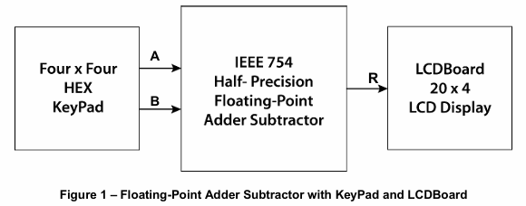
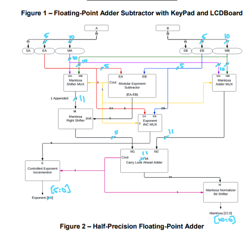
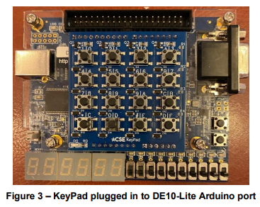
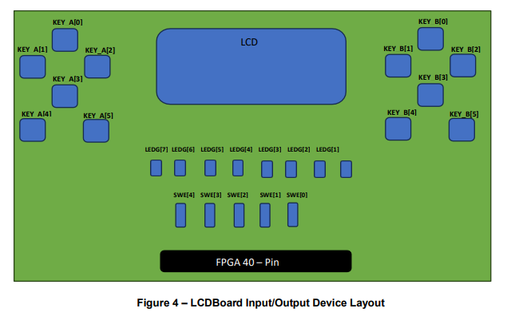

# FPGA Half-Precision Floating Point Calculator

An IEEE-754 half-precision floating-point calculator implemented in Verilog and developed using Intel Quartus Prime. This project demonstrates digital design principles, floating-point arithmetic, FPGA development, and hardware implementation of mathematical operations.

## Overview

This project implements a hardware-based half-precision floating point calculator using Verilog HDL on an Intel MAX 10 FPGA (10M50DAF484C7G). User input is provided through a hexadecimal keypad, processed by a custom floating point arithmetic unit, and displayed on an LCD screen.

The design demonstrates fundamental digital design concepts such as floating point arithmetic, datapath construction, combinational logic design, and FPGA implementation. The arithmetic unit performs exponent alignment, mantissa shifting, and arithmetic operations to support IEEE 754 half-precision floating point calculations.

Unlike traditional calculators that display values in decimal form, this calculator displays values directly in their binary representation. For example:

```
421 → 0100 0010 0001
```

This approach allows users to directly observe how data is represented at the hardware level and better understand binary arithmetic and digital system design.

- 🎥 [Demo Video](https://youtu.be/bcENlHCT4Ro)

##Hardware Platform
FPGA: Intel MAX 10 (10M50DAF484C7G)
Development Environment: Intel Quartus Prime
Language: Verilog HDL
Input Device: Hexadecimal Keypad
Output Device: LCD Display

## System Architecture

### Block Diagram



This block diagram shows the relationship between the input controls, arithmetic unit, floating-point processing modules, and output display system.

### Arithmetic Unit



The arithmetic unit is responsible for processing floating-point operations and routing the results to the display subsystem.

## Hardware Components

### Hex keypad and LCD board




## Features

- FPGA implementation using Verilog
- IEEE-754 half-precision floating-point arithmetic
- Binary input and output display
- Hardware-based computation
- Quartus Prime synthesis and development
- Demonstration of digital logic design concepts

## System Architecture

```text
          +----------------+
          |  Hex Keypad    |
          +----------------+
                   |
                   v
          +----------------+
          | Input Decoder  |
          +----------------+
                   |
                   v
      +-------------------------+
      | Floating Point Unit     |
      |                         |
      |  Exponent Subtractor    |
      |  Mantissa Shifter       |
      |  CLA Adder/Subtractor   |
      +-------------------------+
                   |
                   v
          +----------------+
          | LCD Interface  |
          +----------------+
                   |
                   v
          +----------------+
          |  LCD Display   |
          +----------------+
```

---

## Floating Point Arithmetic Unit

The arithmetic unit is responsible for performing operations on half-precision floating point numbers.

### Exponent Subtractor

The exponent subtractor compares the exponents of two operands and determines their difference. This value is used to properly align mantissas before arithmetic operations are performed.

### Mantissa Shifter

The mantissa shifter aligns the smaller operand by shifting its mantissa based on the exponent difference. Mantissa alignment is required before floating point addition or subtraction can occur.

### Carry Look-Ahead Adder/Subtractor

A carry look-ahead adder/subtractor performs arithmetic operations on aligned mantissas. The CLA architecture provides significantly faster carry propagation compared to ripple-carry designs.

---

## Data Flow

1. User enters operands through the hexadecimal keypad.
2. Input values are decoded into floating point operands.
3. Exponents are compared.
4. Mantissas are aligned using the mantissa shifter.
5. Arithmetic is performed by the carry look-ahead adder/subtractor.
6. The result is sent to the LCD controller.
7. Final output is displayed on the LCD screen.

---

## Skills Demonstrated

- Verilog HDL
- FPGA Design
- Intel Quartus Prime
- Digital Logic Design
- Floating Point Arithmetic
- Datapath Architecture
- Carry Look-Ahead Adder Design
- LCD Interface Design
- Keypad Scanning and Decoding
- Digital System Testing and Verification

---

## Learning Outcomes

This project provided hands-on experience with FPGA-based digital system design. Key areas of learning included hardware implementation of floating point arithmetic, arithmetic datapath development, timing-aware design, peripheral integration, and Verilog HDL development on Intel MAX 10 hardware.
